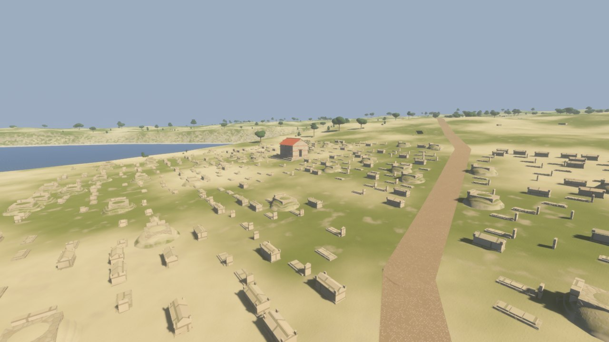
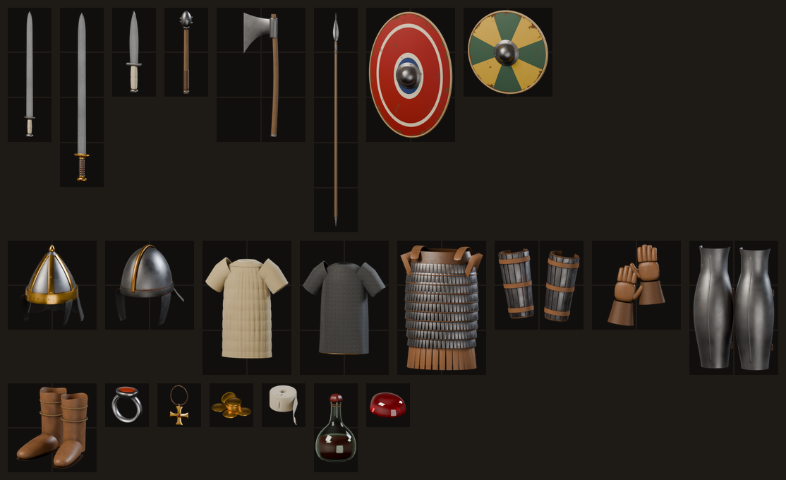
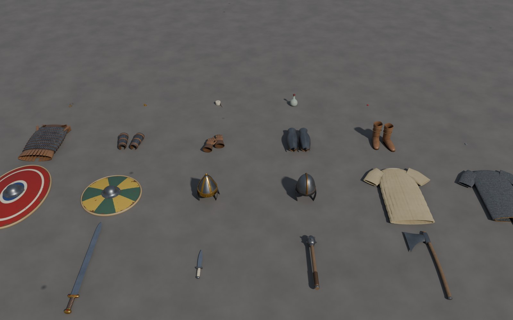
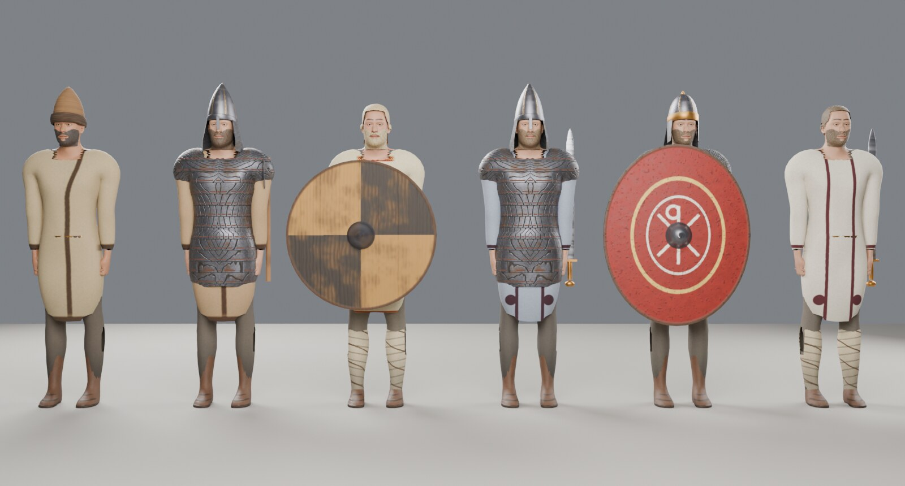
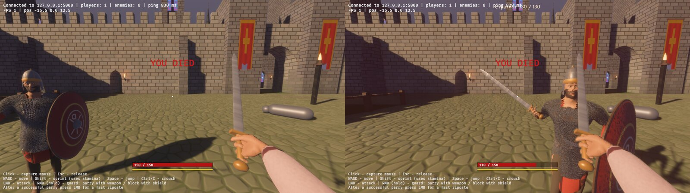

# Medieval RPG — прототип

Многопользовательская средневековая игра от первого лица на Rust и [Bevy](https://bevyengine.org).

Место действия — **Херсонес (Херсон) около 510 года**, форпост Восточной Римской империи в Крыму.


| Базилика епископа | Порт в Карантинной бухте |
|---|---|
|  |  |
| **Некрополь за южными воротами** | **Стан кочевников** |
|  |  |

## Готовая сборка для друзей (без Rust)

Каждый merge в `main` собирает архив **MedievalRPG-windows.zip** (exe + assets) — он лежит в
[Releases → Latest](../../releases/latest). Распаковать, запустить `MedievalRPG.exe`, в главном меню
игры ввести ник и выбрать «Создать игру» или «Подключиться» (адрес вида `abc.at.ply.gg:12345`).
Подробно — в [dist/README-Как-играть.txt](dist/README-Как-играть.txt).

Настройки (графика, экран, мышь, звук) и ник хранятся в `settings.txt` рядом с exe;
по умолчанию — набор «Средние». Esc в игре — пауза и настройки.

## Что нужно установить для разработки (Windows)

1. **Visual Studio** с нагрузкой «Разработка классических приложений на C++» (нужны MSVC и Windows SDK).
2. **Rust**: https://rustup.rs (установка по умолчанию).
3. **Git**: https://git-scm.com.

## Как запустить

```powershell
git clone https://github.com/mezershow1337/Medieval-RPG-Demo.git
cd Medieval-RPG-Demo
cargo run --release
```

Первая сборка идёт долго (5–15 минут), потом быстро.

| Команда | Что делает |
|---|---|
| `cargo run --release` | Главное меню (Создать / Подключиться / Настройки) |
| `cargo run --release -- host` | Сразу хост: сервер и игра на этом компьютере |
| `cargo run --release -- join 192.168.1.5` | Подключиться к другу по его адресу (порт 5000) |
| `cargo run --release -- server` | Только сервер, без окна |

Уровень по умолчанию — Херсонес. Старый готический замок включается переменной окружения
(одинаково у сервера и у всех игроков): в PowerShell `$env:MEDIEVAL_LEVEL="castle"; cargo run --release`.

Чтобы друг подключился через интернет, на компьютере хоста нужно открыть UDP-порт 5000
(или использовать программы вроде Radmin VPN / ZeroTier).

## Управление

| Клавиша | Действие |
|---|---|
| Клик мышью | Захватить мышь |
| WASD | Ходьба |
| Shift | Бег (только вперёд) |
| Пробел | Прыжок |
| Ctrl или C | Присесть |
| ЛКМ | Удар мечом (удары чередуются: справа, слева, сверху), без оружия — кулаком; на предмете — **зажать и тащить** |
| ПКМ | Парирование (кулаками нельзя; со щитом в левой руке — блок) |
| 1 | **Руки**: убрать оружие и драться кулаками |
| 2–9 | Хотбар: взять оружие, надеть/снять щит, применить бинт или зелье (повторное нажатие на оружие в руке убирает его) |
| Колесо мыши | Листать руки и оружие на хотбаре |
| E | Обыскать тело / подобрать предмет / купить товар с прилавка |
| ПКМ с предметом в руках | Бросить |
| Колесо с предметом в руках | Ближе / дальше |
| G (на товаре) | Стащить с прилавка в сумку |
| Tab или I | Инвентарь |
| K | Книга навыков: древо умений, знания |
| F1 | Журнал странника: с чего начать, как развивать каждый навык |
| U (у входа в дом) | Окно усадьбы: купить, снять, обставить комнаты, дать друзьям ключ |
| O | «Вести Таврики»: поселения, цены, слухи, дома на продажу и стройки |
| 2–9 над вещью в инвентаре | Положить вещь на хотбар (или взять мышью и щёлкнуть по слоту внизу; ПКМ по слоту — убрать). По умолчанию 2 — оружие, 3 — щит, 4 — бинт, 5 — зелье |
| F8 | (отладка) положить перед собой тело с добычей |
| Esc | Пауза: продолжить, настройки, главное меню, выход |
| F9 | Эффекты: низкие ↔ прежние (быстро, если игра тормозит) |
| F11 | Полный экран ↔ окно |
| ~ (Ё) | Консоль разработчика (см. ниже) |
| F12 | Снимок бага: картинка с координатами в `screenshots/`, строка в `screenshots/bugs.txt` |

## Консоль разработчика

Клавиша **~** (на русской раскладке **Ё**). `help` — все команды, **Tab** дополняет команды, места и
предметы, **↑/↓** — история, **Ctrl+V** — вставить, **PageUp/PageDown** — листать, **Esc** — закрыть.

Читы (полёт, бессмертие, телепорт, предметы) работают только у **хозяина игры** — у того, кто нажал
«Создать игру», и в одиночной игре. Друзьям их можно разрешить командой хозяина `sv_cheats 1`;
у выделенного сервера — переменной окружения `MEDIEVAL_CHEATS=1`.

| Команда | Что делает |
|---|---|
| `fly` / `noclip` | Полёт (WASD по взгляду, Пробел вверх, Ctrl вниз, Shift ×4) / полёт сквозь стены |
| `speed 3` | Скорость ходьбы и полёта ×3 (`speed 1` — обычная) |
| `god`, `notarget` | Бессмертие и бесконечные силы; враги не замечают |
| `tp agora`, `tp 12 4 -30`, `tp 12 4 -30 1.57 -0.2`, `tp 2` | Телепорт к месту (`places` — список), в точку (с поворотом взгляда), к игроку (`who` — id) |
| `pos` | Координаты; готовая команда `tp …` копируется в буфер обмена |
| `bug текст` (или F12) | Снимок экрана + координаты, место и текст в `screenshots/bugs.txt`, `tp …` в буфер |
| `screenshot` | Снимок с координатами в имени файла |
| `give «Целебное зелье» 3 редкое`, `items зелье` | Выдать предмет (часть названия, количество, качество); найти название |
| `heal`, `kill`, `killall 30` | Вылечить; умереть; убить всех людей в радиусе |
| `spawn goth 3` | Враги-разбойники перед вами: `stratiot`, `bucellarius`, `goth`, `alan`, `hun` |
| `stats`, `wireframe`, `who`, `clear`, `quit` | FPS и координаты в углу; каркас моделей; игроки; очистить; выйти |

Файл `autoexec.cfg` рядом с игрой: команды по одной на строку, выполняются при входе (например `stats`).

## Добыча и инвентарь


* Каждое тело (рыцаря или игрока) остаётся лежать, и его можно **обыскать (E)**. В теле есть и надетые
  на погибшем вещи, и содержимое сумки. Несколько игроков могут обыскивать одно тело одновременно.
* Погибший игрок оставляет в теле **всё**, что у него было, и возрождается с простым набором.
* У вещей шесть качеств: ветхое, обычное, добротное, редкое, эпическое, легендарное. Чем выше качество,
  тем выше урон или броня и тем больше случайных свойств (до 4): сила, ловкость, скорость ударов,
  **окно парирования**, устойчивость блока, удача и другие. Удача убийцы повышает шанс на хорошую добычу.
* Вещи **физически падают** на землю: их можно выбросить из инвентаря и подобрать (E).
  Редкие и лучше светятся лучом, чтобы их было видно издалека.
* Инвентарь — сетка 10×6, предметы занимают несколько клеток (спата 1×3, панцирь 2×3).
  9 слотов экипировки, сумма характеристик видна под ними. У каждого предмета своя 3D-модель:
  иконка в инвентаре — её рендер, а на земле лежит она же (см. «Предметы в 3D»).
* **Бинт** лечит 30 здоровья за 3 секунды перевязки, **зелье** пьётся 1 секунду и лечит 50 за 10 секунд.
  Удар по вам, своя атака или парирование прерывают применение.

| В инвентаре | Действие |
|---|---|
| ЛКМ по предмету | Взять в руку; ЛКМ по клетке или слоту — положить (зелёная подсветка — влезает) |
| ЛКМ мимо окон | Выбросить предмет из руки на землю |
| ПКМ или Shift+ЛКМ | Быстро переложить: из тела в сумку, из сумки в тело, надеть/снять |
| Q над предметом | Выбросить на землю |
| F над предметом (или ПКМ по бинту/зелью) | Использовать |
| «Забрать всё» | Переложить всё из тела к себе |
| Tab, E или Esc | Закрыть |

Всё решает сервер: клиент только просит переложить предмет, а сервер проверяет расстояние до тела
и место в сумке.

## Бой

* Удар идёт в три фазы: **замах → удар → восстановление**. Урон наносится только там, где реально
  проходит клинок, и только если между вами нет стены. Удары идут серией (справа, слева, сверху);
  пауза больше 0,7 с начинает серию заново.
* **Защита (держите ПКМ).** Стойка поднимается за 0,15 с (со щитом за 0,2 с) и закрывает сектор
  примерно ±75° перед вами. Со спины защита не работает. Пока держите стойку, вы идёте медленнее.
  Защиту можно поднять прямо во время своего замаха, отменив удар (финт).
* **Парирование оружием.** Удар, пришедший в поднятое оружие, отражается: нападающий оглушён,
  а у вас появляется окно для **ответного удара (ЛКМ)**: быстрый замах и урон ×1,3.
  Чем сильнее чужое оружие, тем дольше вы сами вздрагиваете после парирования.
* **Блок щитом.** Лёгкий удар (меч) отскакивает от щита и сбивает серию нападающего.
  Тяжёлый удар (двуручник) пробивает темп: нападающий продолжает, а вас качает дольше.
* Клинок, задевший стену, **отскакивает**: короткое оглушение и сброс серии. В тесных коридорах
  бейте сверху.
* Попадание в голову ×1,5. Броня снижает урон. Попадание сбивает чужой замах, но не поднятую стойку.
* Бой стал медленнее: у игрока 150 здоровья, удары медленнее и слабее, враги ходят и бьют реже.
* **Выносливость** (жёлтая полоска под здоровьем). Тратится на бег, удары и на каждый удар,
  принятый на защиту. Если силы кончились в стойке, защиту пробивает и вас оглушает.
  Без сил нельзя замахнуться и бежать. Силы восстанавливаются после короткой паузы, в стойке медленнее.
* **Снаряжение влияет на бой.** Оружие в руке задаёт темп и длину ударов (меч — спата, топор,
  кинжал — сакс, древковое — копьё). «Скорость действий» ускоряет удары, «Устойчивость блока»
  снижает потерю сил при блоке, «Сила» добавляет выносливости, «Ловкость» ускоряет отдых.
  Тяжёлый доспех замедляет ходьбу и восстановление сил.

## Оружие

| Оружие | Удары | Особенности |
|---|---|---|
| Спата | Серия справа, слева, сверху | Ровное оружие, нормально парирует |
| Топор | Как у спаты, короче | Пробивает щит (противник продолжает серию), плохо парирует |
| Сакс (нож) | Быстрые и короткие | Слабый урон, почти не держит удар |
| Копьё (контос) | Только уколы, ~2 м | Держит врага на расстоянии, вблизи неудобно |
| Лук | Натяжение и выстрел | Стрелы летят по дуге; щит их держит, оружием стрелу не отбить |
| Кулаки | Прямые удары | Если правая рука пуста или оружие убрано (клавиша 1). Урон 7 + 0,4 силы, ран не оставляет; парировать голой рукой нельзя, но щит в левой руке блокирует |

## Враги

Люди Херсона и его округи около 510 г.

| Враг | Оружие | Поведение |
|---|---|---|
| Стратиот (гарнизон) | Спата и овальный щит | Часто закрывается щитом, обходит сбоку, если вы в стойке |
| Букелларий (гарнизон) | Спата и овальный щит, ламеллярный доспех | Медленный и крепкий, закрывается почти всегда |
| Готский воин | Топор и круглый щит | Напирает и часто рубит, топор продавливает ваш щит |
| Аланский копейщик | Копьё-контос | Держит дистанцию копья; парируйте и подходите вплотную |
| Кочевник-лучник | Лук, вблизи нож | Стреляет издали и отходит; поднимите щит или сократите дистанцию |

У каждого свой облик эпохи: стратиот в кольчуге и спангенхельме, букелларий в ламелляре и высоком
шлеме, гот в тунике с тканой каймой, с длинными волосами и бородой, алан в кафтане и ламелляре,
кочевник в кафтане и войлочной шапке. Подробнее — в разделе «Модели людей».

Люди стоят на постах: стража у ворот, в цитадели и на агоре, готская деревня, аланский и кочевой
лагеря, разбойники в холмах и балках. **Разбойники** нападают всегда. Стража, готы, аланы и кочевники
не трогают вас, пока вы не напали на кого-то из них (тогда в бой вступают товарищи рядом, а фракция
злится) или пока репутация у фракции не упала до вражды. Далеко от поста они за вами не погонятся.

## Херсонес, 510 год

Город и его округа примерно 1,8 × 1,8 км, ясный летний день. Всё сделано кодом (процедурная геометрия
и свои шейдеры), без чужих моделей. Размеры — по раскопкам: кварталы, улицы и стены в масштабе 1 : 1,
кварталов меньше, чем в настоящем городе (около двух третей площади).

**Стены и ворота.** Куртины из крупных известняковых блоков 9 м высотой и 3,5 м толщиной с зубцами,
прямоугольные башни, круглые угловые башни и **башня Зенона** (Ø 19 м) в юго-восточном углу — её подновили
в 488 г. на таможенные сборы, на ней мраморная плита с надписью. Перед южной (сухопутной) стеной —
низкая **протейхизма** с периболом между стенами. Главные ворота, южные ворота к некрополю, портовые ворота
к бухте. На стены ведут лестницы, по верху можно ходить.

**Город.** Регулярная сетка: главная продольная улица ~6 м, мощёная плитами с крытым водостоком,
поперечные улицы ~3,5 м, кварталы 23 × 47 м, в каждом две усадьбы с двором, цистерной, пифосами, смоковницей
или виноградной лозой. Дома из бута или белёные, одно- и двухэтажные, под черепицей; в фасадах — лавки.

* **Агора** со стоями, фонтаном-водоразборником, колонной с крестом и рядами торговцев.
* **Базилика епископа**: атриум с фиалой, нартекс, трёхнефный зал на мраморных колоннах, апсида с синтроном,
  алтарь под киворием, амвон, мозаичный пол; рядом **баптистерий** с куполом и крестообразной купелью.
* **Ксенон** (больница при епископии): палаты с койками, кабинет врача (ятрейон), кладовая лекарств и кухня,
  огород лекарственных трав во дворе.
* **Дидаскалион** (школа): аудитория со скамьями и кафедрой, книгохранилище со шкафами для свитков.
* **Аптеки** у агоры и у порта, **лавка книжника**, **корчмы**.
* **Дом знатных ссыльных** с мозаиками, триклинием и фонтаном.
* **Термы**: залы со сводами, бассейны, топка, палестра. **Заброшенный театр** — зрелища запрещены,
  камень разбирают на стройки. **Резервуар водопровода** 28 × 13 м.
* **Цитадель** у бухты: претория, казармы, зернохранилище, бани гарнизона, плац с чучелом.
* **Мастерские**: стекольная (купольная печь, отжиг, стеклянная посуда), гончарная (две печи, круг, сушильни),
  кузница, винодельня-тарапан с давильнями, рыбозасолочные цистерны из цемянки.
* **Порт** в Карантинной бухте: каменная набережная, пирсы, торговый корабль, лодки, кран, грузы,
  портовый торг, таможня (коммеркиарий), склады-горреи.

**Округа.** Плато Гераклейского полуострова с балками, морем на севере и бухтами по бокам.
Грунтовые дороги ведут к **некрополю** (плитовые могилы со стелами-крестами, саркофаги, склепы,
поминальная церковь), к **клеру** (виноградники за каменными оградами, усадьба с башней и давильней),
к **роднику** в балке, к **селению крымских готов** (каменные дома под камышом на террасах, ток, загон),
к **стану гунно-булгар** (войлочные юрты, кибитки, коновязь) и к **аланскому стану** (кольцо повозок, шатры).
Склоны — можжевельник, крымская сосна, дуб пушистый, известняковые выходы. Лекарственные травы растут
там, где им положено: шалфей и чабрец — на каменистых склонах, полынь — в степи, белена и мальва — у дорог
и жилья, мята, окопник и девясил — по сырому дну балки у родника.

Для других частей игры в коде есть именованные места (`level::places()`: агора, ксенон, дидаскалион,
аптеки, мастерские, станы и т. д.), заросли трав (`level::herb_patches()`), посты стражи и разбойников
(`level::npc_posts()`) и очаги (`level::hearths()`). Тесты проверяют, что до каждого места в городе
можно дойти от агоры и что ни одна точка не стоит в стене.

## Замок

Готический замок примерно 100 × 120 м, закатный вечер (`MEDIEVAL_LEVEL=castle`).

| Двор | Неф собора | Замок сверху |
|---|---|---|
|  |  |  |

* **Надвратная башня** с узким проездом под стрельчатым сводом и поднятой решёткой.
* **Большой двор**: фонтан, колодец, кузница с горном, конюшня, тренировочная площадка, лестницы на стены
  (по верху стен можно ходить).
* **Внутренняя стена** с главными воротами и двумя узкими калитками — удобные места для засад.
* **Собор**: неф со стрельчатыми крестовыми сводами и нервюрами, боковые нефы за аркадой, витражи,
  роза на фасаде, хоры с троном, люстры. Снаружи — контрфорсы с аркбутанами и пинаклями, башни со шпилями.
* **Клуатр** слева от собора: крытая галерея с аркадой вокруг сада.
* **Казармы** справа: коридоры и комнаты (спальни, трапезная, арсенал, склад).
* Между ними и собором — **узкие проходы** между контрфорсами и коридор вдоль северной стены.

Графика — собственные шейдеры (`src/shaders`): процедурная каменная кладка с рельефом, мхом и грязью у земли,
плиты пола, брусчатка, дерево, сланцевая черепица, витражи со свинцовыми переплётами, живое пламя факелов,
вода, угли в горне, закатное небо с облаками и горами. Плюс HDR, блум, SSAO, сглаживание TAA,
объёмный туман с лучами солнца и мерцающий свет факелов.

Враги возрождаются через 60 секунд, игрок — через 5 секунд (ещё 4 секунды после появления враги его не трогают).
После смерти тело остаётся лежать на земле.

## Торговля и фракции (Херсон, 510 год)


Деньги — как после реформы Анастасия (498 г.): **солид** (золото, 1/72 фунта), **тремисс** (треть солида),
медный **фоллис** с буквой «M» (40 нуммиев) и **декануммий** (10 нуммиев). Курс — около 180 фоллисов за солид.
При оплате торговец сам отсчитывает сдачу. Поденщик зарабатывает около 6 фоллисов в день, кольчуга стоит
два солида, переписанный Гален — три.

* **21 торговец и мастер**: в порту — навикулярий из Синопы (вино, масло, стекло), сириец с пряностями
  и благовониями, торговец серой, квасцами и боспорской нефтью; на агоре — лавочник, книжник, аптекари,
  красильщик; в мастерских — стеклодув, гончар, медник; рыбозасольщица; врач монастырского ксенона;
  казначей гарнизона; опальный сенатор и сосланный философ; хозяин портовой таверны (скупщик краденого);
  за стенами — готский староста из Дори, аланский старейшина и торговец кочевой орды.
* Цена зависит от лавки, запаса на полке и **отношения фракции** к вам. Каждый покупает только своё
  (порт охотно берёт рыбу, соль, шкуры, воск и мёд — их и везли из Херсона).
* **За стенами — мена**: медь там не берут, золото ценят, платят товаром. Выгодный круг — вино в степь,
  степной ревень и солодку обратно сирийцу.
* **Заказы**: стеклодув выдует алембик или реторту, медник — керотакис и весы, книжник перепишет
  Орибасия. Половина вперёд, вещь готова через несколько минут, заказная чаще выходит добротной.
* **Учёба и работа**: платные уроки у мастеров, работа подмастерьем и смены в ксеноне (платят гроши,
  но учат). Нельзя отходить от мастера, пока урок не кончится; X — бросить.
* **Кража** (кнопка «Стянуть» у мелких вещей): легче, когда торговец отвлёкся («пересчитывает выручку»).
  Пойманный платит по римскому праву **четверную цену**, теряет репутацию и попадает в розыск: пока штраф
  не уплачен казначею гарнизона, горожане не торгуют. Краденое лучше сбыть скупщику — хозяин вещь узнает.
* **Оружие варварам** продавать запрещено законом: кто-нибудь может донести в гарнизон.
* **Обмен между игроками**: посмотрите на игрока и нажмите **T**, он отвечает **Y/N**. Каждый выкладывает
  вещи и деньги, обмен проходит, когда согласны оба (любое изменение снимает согласие).
* **Фракции (J)**: гарнизон, граждане, церковь, заморские купцы, ссыльные, крымские готы, аланы,
  кочевники, портовое дно. Отношения связаны: помощь готам радует гарнизон и злит кочевников.

| Клавиша | Действие |
|---|---|
| E (на торговца) | Говорить и торговать |
| T (на игрока) / Y / N | Предложить обмен / принять / отказать |
| J | Отношения фракций и розыск |
| X | Бросить урок или смену |

## Физика предметов и вес

* Каждый предмет в мире — **твёрдое тело со своей физикой**: коробка по размерам его 3D-модели и масса
  по настоящему весу. Брошенное кувыркается, отскакивает, скатывается со склона, ложится на стол;
  люди расталкивают лежащее ногами. Движок свой (`src/props.rs`), без сторонних библиотек.
* **Как в Skyrim**: наведите прицел и **зажмите ЛКМ** — предмет у вас в руках и тянется за взглядом.
  Отпустили — летит дальше сам (можно «швырнуть» рывком мыши), **ПКМ** — бросок, **колесо** — ближе/дальше.
  Лёгкое летит далеко, амфора вина (17 кг) поднимается тяжело и проседает, а больше ~35 кг поднять
  нельзя — только волочь по земле. ЛКМ мимо предмета или во время замаха — обычный удар.
* **Вес у всех 122 предметов** (`src/weight.rs`): спата 1,1 кг, кольчуга 9,5, ламеллярный панцирь 13,
  амфора вина 17, солид 4,5 г, пучок шалфея 50 г. В инвентаре видно вес вещи и всю ношу; больше
  35 кг (+1 кг за каждую единицу силы) — шаг медленнее, вдвое больше — на 40 %.
* Сервер считает физику и рассылает только движущиеся предметы (~30 раз в секунду, свой канал 9);
  свой предмет в руках клиент двигает сразу и мягко сверяет с сервером.

## Товар на прилавках

* Всё, что есть у торговца на полке, **лежит на его прилавке настоящими предметами** (стол, а у кого
  рядом свободно — ещё боковой столик; за стенами — войлок на земле). Купили — товар исчез, подвезли — появился.
* Наведите прицел: товар подсвечивается, видно **цену для вас** (с учётом отношения фракции), вес,
  сколько штук есть и чем занят торговец. **E** — купить одну штуку.
* Товар можно **взять в руки** и рассмотреть. Унесёте дальше полутора метров — это **кража на глазах**:
  попасться легче, чем при ловкой краже, большую вещь видно всегда. Поймали — товар возвращают,
  штраф в четверную цену и розыск, как при обычной краже; не поймали — вещь ваша (и краденая).
* **G** — стащить мелочь прямо в сумку (как «Стянуть» в окне торговца).
* Сдвинутое или уроненное торговец через несколько секунд кладёт на место.

## Кузнечное дело

Кузницы есть в каждом поселении: кузница Филиппа в городе, оружейная гарнизона в цитадели, кузница и сыродутный горн у готов, полевые горны степняков и аланов, кузница в замке. Всё по-настоящему, от руды до рукояти, без магии.

- **B** у наковальни — окно кузни. **Пробел** — качнуть мехи (в такт, примерно раз в секунду: держать бесполезно, частить — мехи не набирают воздух), **F** — переложить поковку из горна на наковальню и обратно, **R** — перевернуть поковку клещами на другую грань.
- **Переворачивать**: удары по одной грани тянут её сильнее — полосу выгибает. Каждые несколько ударов переворачивайте заготовку, иначе выйдет кривая вещь.
- **Жар** виден только цветом каления: тёмно-вишнёвый, вишнёвый, красный, оранжевый, жёлтый, белый. Названия цветов и подсказки открываются техниками. Холодное железо трескается, пережжённое горит искрами.
- **Ковка**: над участками поковки качается маятник. ЛКМ — лёгкий молот, ПКМ — тяжёлый; чем ближе к середине в миг удара, тем точнее. Навык расширяет «сладкую» зону и уменьшает промахи.
- **Закалка** в воде, рассоле или масле (масло и соль из сумки), **отпуск** на краю горна по цветам побежалости, **отжиг** в золе, **точило**, сборка с рукоятью (бронзовое навершие — лучше развесовка).
- **Литьё** только бронзы, серебра и свинца (железо в 510 году не льют): тигель в горн, снять шлак, согреть форму, лить без перерыва, разбить форму, зачистить.
- **Сыродутный горн**: руда и уголь, ровное дутьё — получится крица; её проковывают на белом жару в полосы. **Цементация** превращает железную полосу в стальную.
- **Качество вещи** складывается из формы, сварки, трещин, окалины, закалки и отпуска, заточки. От него зависят урон, бонусы (кромка, развесовка, окно парирования), прочность и вид: грубая работа выглядит тёмной, в окалине и ржавчине, хорошая блестит. В подсказке видно мастера, прочность, кромку, развесовку и изъяны.
- **Износ**: оружие, щиты и доспехи тупятся и мнутся в бою; ниже половины прочности слабеют, сломанные — на треть силы. Кузнецы-торговцы правят и точат за деньги, можно и самому у горна.
- **Учиться**: навык «Кузнечное дело» растёт от работы, техники открываются у мастеров (Филипп, Виталиан, готский, степной и аланский кузнецы), по «Естественной истории» Плиния или сами — методом проб и ошибок.
- **Зрелище**: поковка светится по жару и видна всем в клещах, молот бьёт с искрами окалины, при закалке клинок опускают в корыто, шипит и валит пар, масло вспыхивает, с точила летит сноп искр, угли разгораются от мехов, тигель льёт струю металла. Звуки (звон наковальни, шипение, бульканье, точило, треск) синтезируются в коде.
- Для снимков: `MRPG_SMITH_DEMO=<номер горна>[,фаза]` — призрачный кузнец куёт спату по кругу; `MRPG_SMITH_KIT=1` на сервере кладёт в сумку набор для пробы; `MRPG_SMITH_SHOWCASE=weapons|armour|sword|seax|axe|mace|spear|head|archery[,x,y,z]` раскладывает вещи на земле (ряды: грубая, средняя, отличная работа).

### Арсенал: 80 видов оружия

Сверх старых шести — 74 вида кованого оружия Херсонеса около 510 года и три вида наконечников стрел: мечи (семиспата, спата букеллария, готские, гепидские, франкские, вандальские, аланские, гуннские, сасанидский, степной слегка изогнутый…), саксы и ножи (скрамасакс, пугион, сика…), топоры (франциска, бородовидная секира, долабра…), булавы и кистени, копья и дротики (контос, ланкия, менавлон, ангон, плюмбата, пилум…). Алебард и сабель в VI веке ещё нет — вместо них исторические предшественники.

- У каждого вида — рецепт в кузне (раздел по семейству), число полос, нужная техника, детали сборки, лучший отпуск, урон и врождённая быстрота, цена, вес, описание и образец (чья работа), 3D-модель и иконка.
- Данные — в `tools/arsenal_data.py`; `python3 tools/gen_arsenal.py` пишет `src/arsenal_table.rs` и блок видов в `src/items.rs`. Модели строит `tools/models/items_arsenal.py` по параметрам записи.
- Торгуют оружием своих народов Филипп, Виталиан, Ансила, Ирник и Кандак.

### Луки и стрелы

- **Луки**: простой (ясень) и гуннский составной с костяными накладками. Лук игрока тратит по стреле на выстрел — из первой стопки стрел в сумке; без стрел не выстрелить.
- **Стрелы**: обычные (листовидные), бронебойные (пробивают доспех, урон ниже), трёхлопастные гуннские (урон и немного пробивания), срезни (страшные раны, но от доспеха отскакивают). Качество стрелы прибавляет урон.
- **Цепочка**: кузнец куёт наконечники → на верстаке у кузни (вкладка «Стрелы») из ясеневой заготовки строгают 10 древков → сборка 10 стрел: наконечники, древки, 30 маховых перьев и рыбий клей (или сухожилия). Качество — от худшего наконечника, навыка и аккуратности работы.
- Перья продают Андроник и Филипп, рыбий клей — Феодора, сухожилия и составные луки — Ирник.

## Звук и музыка

Все звуки и музыка **синтезированы для игры** генератором `tools/audio` (numpy + scipy, без чужих
записей), поэтому никаких сторонних лицензий у них нет. Пересобрать: `python3 tools/audio/build.py`
(нужен ffmpeg с libvorbis); можно по частям: `--only sfx|ambient|music` и имена звуков.

* **Шаги** звучат по тому, на чём стоишь: известняк и мрамор, доски, утоптанная земля, сухая трава,
  ковры, черепица, вода. Воины в доспехах позвякивают кольчугой. Приземление после прыжка, тяжёлое
  дыхание, когда кончаются силы.
* **Бой**: свист клинка (топор и копьё — тяжелее), звон парирования, удар в щит, удар по кольчуге или
  по телу, пробитая защита, вскрики, падение тел, тетива, свист стрелы у самого уха, стук стрелы.
* **Руки и вещи**: двери на кованых петлях, вещи падают по материалу (железо, дерево, глина, ткань),
  бронзовые монеты, шорох сумки, перевязка (рвётся полотно), питьё, чтение, сбор трав, ступка,
  кипение сосудов, шипение, вспышки; кузница — свои звуки в `smithing_fx.rs`.
* **Голоса** без слов: жители бормочут с греческим ритмом слогов, отвечают на «E».
* **Окружение** следует за местом: прибой у бухты, ветер (на стенах сильнее), гул улиц, торг на агоре,
  степь за стенами, вечерние сверчки и сплюшка, тишина дома под крышей, гулкая базилика; чайки над
  морем, собаки, телеги, петух, овцы и осёл у сёл, **семантрон** у храма (колоколов в 510 году ещё нет).
* **Музыка** в духе ранней Византии: кифара, авлос с бурдоном, тимпан, кимвалы и церковное пение с
  исоном. Лады — византийские (октава в 72 мориях): первый глас, четвёртый (легетос), плагальный второй
  с твёрдой хроматикой. Пьесы для города, вечера, ночи, храма и боя (7/8) сменяются плавно; спокойная
  музыка звучит волнами, с тишиной между пьесами.
* Звуки **других игроков** слышны там, где они есть: клиент выводит их из тех же снимков сервера,
  по которым рисует движения, поэтому протокол не менялся.
* Громкость: в настройках «Громкость» (общая, `GlobalVolume`) и отдельно «Музыка», «Эффекты», «Окружение» —
  `audio::AudioSettings`. Отладка: `MRPG_AUDIO_LOG=1` пишет в лог, где уши, что вокруг и что звучит.

## Работа руками

Ни одно ремесло не идёт само, пока игрок стоит и смотрит на полоску. Всё делается руками от первого лица: мышь перестаёт вертеть головой и работает инструментом, перед глазами — ступка, горшок, мехи, молот, свиток или повязка, сбоку — шкала с подсказкой и оценкой каждого движения. Как сделано — так и выйдет.

| Занятие | Движение |
|---|---|
| Растирать в ступке, толочь корни, растирать чернила | круги мышью ровным темпом (зелёная точка показывает нужную скорость) |
| Варить в горшке, настаивать, ворошить на решётке, мешать красильный чан | круги мышью медленнее; быстро — расплещете, бросите мешать — дело встанет, а на огне пригорит |
| Перегонка и обжиг в тигле, копать корень, носить воду, топить печь | мышь вверх-вниз на полный ход в такт; под алембиком каждый качок раздувает угли — перекачаешь, купол перегреется |
| Обрывать листья, бить кувалдой по указке кузнеца | ЛКМ, когда маятник посередине |
| Читать | вести указку мышью за словом; стоящая указка не читает |
| Срывать траву, перевязывать, вынимать наконечник | держать ЛКМ так, чтобы натяжение было в светлой зоне; перетянете — порвёте |
| Платный урок | мастер показывает 3–5 движений, повторите их мышью |

- **Что от этого зависит**: качество отвара и мази (растёрто комками, мешали кое-как, мехи качали рывками), сколько травы собрано и не загублен ли куст, удача при извлечении наконечника, сколько знаний взято с урока (×0.5…1.3), сколько заплатит мастер за смену (×0.5…1.2). Навык расширяет хорошие зоны и сглаживает огрехи.
- Уроки и смены у мастеров-торговцев (подмастерье стеклодува, смена в ксеноне и т. п.) работают так же: смена кончается, когда работа сделана, а не когда прошло время.
- Выпить настой или лекарство — просто выпить: там движения нет.
- Для снимков: `MRPG_WORK_DEMO=grind|stir|pump|rhythm|track|tension|mimic` — руки сами показывают движение.
- Код: `src/work.rs` (движения, оценка, учёт на сервере, тесты), `src/work_client.rs` (шкала и инструмент в руках).

## Навыки, умения и журнал

Десять навыков (0–100): сила, выносливость, ратное дело, стрельба из лука, кузнечное дело,
алхимия, травничество, врачевание, книжность, торговля. Каждый растёт от своего дела
(бой — попадания и отражённые удары, лук — попадания, ноша — сила, бег и бой — выносливость,
сделки — торговля, чтение и уроки грамоты — книжность), а связанные растут вместе: кузнец крепнет,
боец становится выносливее, лекарь лучше знает травы.

Умения (34) приходят сами, когда набраны навыки — часто из разных ветвей — и выучены нужные
знания: «Хирургу» нужны врачевание, приёмы Цельса и «Травник-лекарь», который сам просит травничества.
Умения дают небольшие прибавки: к урону и защите, к ноше и выносливости, к ценам, к скорости чтения
и к навыку в ремесле. Окно — K (наведите на умение — подсветятся связи), журнал — F1.
Подсказки новичку появляются справа по одной и выключаются в журнале.

Для снимков: `MRPG_DEBUG_SKILLS=1` (игрок с навыками), `MRPG_SHOT_UI=skills|knowledge|journal[:глава]|hint`,
`MRPG_SHOT_FOCUS="Тяжёлая рука"` — закрепить описание умения.

## Живые поселения и свой дом

Мир живёт сам, даже когда игроки сидят в одном квартале. Раз в игровую неделю (по умолчанию 4 минуты,
константа `DEFAULT_WEEK_SECS` в `src/towns.rs`, у хоста — переменная `MRPG_WEEK_SECS=секунды`) хост пересчитывает семь поселений Таврики и Понта: **Херсон** (около 10 тыс. жителей),
**готское село** в горах, **Дорос** (столица крымских готов), **аланский стан**, **кочевья гуннов-утигуров**,
**Боспор** и **Синопу** за морем. Календарь начинается 1 сентября 510 года.

- **Хозяйство**: у каждого поселения свой запас хлеба, рыбы, соли, вина, масла, тканей, кож, железа, леса и
  привозного товара. Готы и аланы растят хлеб, степь гонит скот и шкуры, Херсон солит рыбу и живёт подвозом.
  Хлеб везут обозами и кораблями по 11 путям; с ноября по март **море закрыто** — кораблей нет, цены
  на привозное растут к весне, а после жатвы (июль–август) хлеб дешевеет.
- **Цены в лавках** Херсона следуют за запасами: в голодный год зерно и хлеб у торговцев дорожают, полки пустеют;
  в урожайный — наоборот. Таможня берёт октаву (12,5 %) с привоза.
- **Люди**: рождаются, умирают, бегут от голода и переселяются в город, где есть работа и жильё.
  Казна и настроение горожан решают, что строить: дома, стены или мастерские.
- **События**: неурожай, мор (поветрия случались и до Юстиниановой чумы 541 года), падёж скота, набеги
  (из степи к стенам Херсона приходят разбойники — их видно в мире), праздники. Глашатай на агоре
  объявляет главное, всё остальное — в окне **O**.
- **Стройки**: на четырёх пепелищах Херсона дома строятся по этапам — расчищенные руины, фундамент,
  стены в лесах, кровля с черепицей, готовый дом. Когда дом достроен, курия выставляет его на продажу.

**Свой дом.** Пустующие усадьбы Херсона и мазанка в готском селе продаются и сдаются. Подойдите к входу —
появится подсказка **[U]** с ценой. Цена — как в папирусах VI века: от 2 солидов за мазанку до 25 за двухэтажную усадьбу, в зависимости от
числа комнат, второго этажа, спроса и мора; аренда — около 1/90 цены в месяц. В своём доме:

- двери и сундуки открываются только хозяину и тем, кому он дал **ключ** (друзьям в игре);
- в сундуках можно **хранить вещи** — они остаются после выхода из игры и перезапуска хоста;
- каждую комнату можно **обставить** на заказ: триклиний, спальня, кухня, кладовая, ткацкая,
  мастерская, на втором этаже — горница. Мастера делают за 1–2 недели, мебель появляется в доме у всех;
- аренду можно продлить или съехать, дом — продать курии за 70 % цены.

Всё состояние мира (поселения, стройки, хозяева, обстановка, вещи в сундуках) хост сохраняет в
`herson-world.json` в папке данных игры (`MRPG_DATA_DIR`, отключить — `MRPG_SAVE=off`). Игрока узнают
по ключу из `profile.txt` рядом с данными — дом остаётся за вами, даже если вы зашли с другим id.

## Устройство кода

| Файл | Что внутри |
|---|---|
| `src/main.rs` | Запуск в режиме хоста, клиента или сервера |
| `src/protocol.rs` | Сетевые сообщения между клиентом и сервером |
| `src/server.rs` | Сервер без графики: игроки, проверка перемещений, рассылка состояния |
| `src/client.rs` | Окно игры, подключение, отображение других игроков |
| `src/player.rs` | Управление персонажем и камера от первого лица |
| `src/collision.rs` | Своя простая физика: столкновения со стенами, ступеньки, склоны холмов, сетка для быстрого поиска |
| `src/level.rs` | Общий сборщик уровня (коробки-коллизии, меши по участкам 64 м, свет), выбор уровня |
| `src/level/city.rs` | Херсонес: сетка кварталов, улицы, что стоит в каком квартале |
| `src/level/city/*.rs` | Стены и башни, дома, общественные здания, мастерские, порт, округа; `kit.rs` — стены, крыши, утварь, деревья |
| `src/level/terrain.rs` | Рельеф: берег, бухты, балки, холмы; карта высот для ходьбы и меш земли |
| `src/level/places.rs` | Именованные места, заросли трав, посты, очаги — для торговли, обучения, врагов |
| `src/level/castle.rs` | Старый готический замок |
| `src/level/geom.rs` | Процедурная геометрия: арки, своды, купола, тела вращения, крыши, шпили |
| `src/graphics.rs` | Материалы, небо, солнце, пост-обработка (блум, SSAO, TAA, объёмный туман) |
| `src/shaders/*.wesl` | Шейдеры: камень и другие поверхности, витражи, пламя, небо |
| `src/combat.rs` | Общая логика боя: фазы удара, траектория клинка, стойка, парирование, блок щитом, ответный удар |
| `src/npc.rs` | ИИ рыцарей (только на сервере) |
| `src/fight.rs` | Бой на клиенте: ввод, меч в руках, искры, надписи |
| `src/hud.rs` | Прицел и строка состояния |
| `src/hotbar.rs` | Хотбар внизу экрана: руки, оружие, щит, расходники; цифры и колесо |
| `src/gear_look.rs` | Что видно из надетого (шлем, доспех, перчатки, поножи, щит, оружие, крест, перстень, колчан) — уходит в снимках сервера |
| `src/worn.rs` | Вещи на теле своими моделями: оружие в руке, на поясе и за спиной, колчан, крест, перстень |
| `src/rig.rs` | Модели людей и их анимация (скелет со скином, IK рук и ног, кулак по оси оружия) |
| `src/rig_dims.rs` | Размеры скелета под тело из glb (создаётся `tools/models/build_humans.py`) |
| `src/items.rs` | Предметы, качество, случайные свойства, таблицы добычи |
| `src/inventory.rs` | Логика инвентаря: сетка, экипировка, обмен, стопки |
| `src/loot_net.rs` | Сетевые сообщения добычи (свой канал) и полёт брошенных вещей |
| `src/loot_server.rs` | Сервер: тела с добычей, вещи на земле, инвентари игроков |
| `src/loot_client.rs` | Клиент: модели вещей и тел, подсказка «E», приём состояния |
| `src/icons.rs` | Какая 3D-модель и иконка у каждого предмета (`ITEM_ART`), их загрузка |
| `src/consumables.rs` | Сервер: бинты и зелья, лечение |
| `src/inventory_ui.rs` | Окно инвентаря и обыска, шрифт с кириллицей (Lora, OFL) |
| `src/economy.rs` | Монеты 510 года, оплата со сдачей, справочные цены |
| `src/factions.rs` | Фракции, репутация и её отголоски, преступления и штрафы |
| `src/trade.rs` | Торговцы и мастера, виды товаров, формулы цен, бартер, вероятность кражи |
| `src/trade_net.rs` | Сетевые сообщения торговли (канал 7) |
| `src/trade_server.rs` | Сервер: полки, сделки, заказы, уроки, кража, штрафы, обмен между игроками |
| `src/trade_client.rs` | Клиент: торговцы с прилавками, клавиши E/T/Y/N/J/X |
| `src/trade_ui.rs` | Окна торговли, обмена и репутации |
| `src/trade_icons.rs` | Иконки монет и товаров |
| `src/skill_tree.rs` | Навыки и умения: условия, связи между ветвями, поправки (`Mods`) |
| `src/skills_server.rs` | Сервер: опыт от боя, ноши, бега и сделок, умения и их поправки |
| `src/skill_book.rs` | Окно книги (K/F1): древо навыков, знания, журнал |
| `src/guide.rs` | Текст журнала: с чего начать, кто учит, какие книги |
| `src/hints.rs` | Подсказки новичку (один раз каждая, выключаются) |

| `src/towns.rs` | Поселения Таврики: календарь, запасы, торговые пути, люди, события, стройки (чистая симуляция) |
| `src/estates.rs` | Дома: цены, аренда, профиль игрока, сообщения канала 13 |
| `src/towns_server.rs` | Сервер: недели мира, сделки с домами, замки дверей и сундуков, набеги, сохранение |
| `src/towns_client.rs` | Клиент: подсказка [U], окно усадьбы, «Вести» (M), глашатай, стройки и мебель |
| `src/level/city/estate.rs` | Усадьбы и стройплощадки в уровне: комнаты, варианты обстановки, стадии стройки |

## План

1. ✅ Фундамент: сеть, персонаж, замок из блоков.
2. ✅ Большой готический замок с процедурной геометрией и шейдерами.
3. ✅ Ближний бой и парирование, враги-рыцари.
4. ✅ Тела, которые можно обыскать, инвентарь, предметы разного качества.
5. ✅ Реалистичные модели людей эпохи (Херсонес, 510 г.) с анимацией.
6. ✅ Херсонес около 510 года: город, порт, округа, станы соседей, места для торговли и обучения.

## Предметы в 3D



Действие перенесено в Херсонес около 510 года, поэтому и предметы — того времени: спата и
кавалерийская спата с золочёной гардой и гранатами (как мечи из керченских погребений), пехотное копьё,
боевой топор, овальный и круглый расписные щиты с умбонами, спангенхельм и гребенчатый шлем,
стёганая туника, кольчуга, ламеллярный панцирь с птеругами, ламеллярные наручи, железные поножи,
кожаные сапоги и перчатки, серебряный перстень с сердоликом, нательный крест, золотые солиды,
льняной бинт, стеклянный флакон с лекарством, рубин-кабошон.

Каждый предмет — настоящая 3D-модель, собранная кодом в Blender (`tools/models/build_items.py`,
материалы и геометрия процедурные, чужих ассетов нет). Из одной модели получаются:

* `assets/icons/items/<ключ>.png` — иконка для инвентаря, рендер Cycles со студийным светом
  (128 px на клетку, с прозрачным фоном);
* `assets/models/items/<ключ>.glb` — та же модель для мира: текстуры (цвет, шероховатость, металл,
  нормали) запечены из процедурных материалов, предмет уже лежит «как на земле».



Старые названия предметов (одноручный меч, топфхельм, латная кираса…) по-прежнему понимает
`ItemBaseId::by_name` — таблица `RENAMED` в `src/items.rs`.

### Как добавить предмет

1. Описать вид предмета в `ITEM_BASES` (`src/items.rs`).
2. Написать функцию модели в `tools/models/build_items.py` (снаряжение) или `tools/models/items_goods.py`
   (товары, травы, посуда, книги, снадобья) с декоратором
   `@item("ключ", (ширина, высота), name="Название из items.rs", pose=...)` — размер в клетках тот же,
   что в `items.rs`; поза `"flat"` (кладётся плашмя) или `"upright"` (стоит). Готовые детали и материалы —
   в `tools/models/itemkit.py` (тела вращения, клинки, трубы по кривой, металл, дерево, кожа, ткань, стекло)
   и семейства в `items_goods.py` (пучок трав, горка в плошке, флакон, кувшин, кодекс, свиток…).
3. Собрать только его: `python3 tools/models/build_items.py ключ` (нужно `pip install bpy numpy pillow`).
   Скрипт сам допишет пару «название → ключ» в `src/icons/art.rs`.
4. `cargo test` проверит, что файлы есть и иконка совпадает с размером в клетках. Пока у предмета нет
   своей модели, в инвентаре у него временная плоская иконка, а на земле — холщовый мешочек.
5. Посмотреть результат: `python3 tools/models/preview_items.py ключ` (лист иконок и рендер на полу в `docs/`).

## Модели людей



Слева направо: кочевник-лучник, аланский копейщик, готский воин, букелларий, стратиот и игрок.
Все модели реалистичные и собраны кодом (`assets/models/humans.glb`):

* **Тело** — базовый меш [MakeHuman](https://github.com/makehumancommunity/makehuman) (лицензия CC0)
  с мужскими пропорциями, рост 1,75 м. Скелет из 15 костей подогнан под анимацию игры, веса
  MakeHuman сведены к нашим костям и сглажены у плеч, кисти заранее сжаты в кулак под рукоять.
* **Одежда эпохи** — оболочки поверх тела: ромейская туника с пурпурными клавами и орбикулами,
  готская туника с тканой каймой, кафтан кочевника, штаны, обмотки-фасции, сапоги и башмаки,
  пояс с бронзовыми накладками, кольчуга, ламеллярный доспех; волосы и борода.
* **Шлемы** — спангенхельм на бронзовом каркасе с нащёчниками и бармицей, высокий клёпаный шлем
  с наносником, войлочная шапка с меховым отворотом.
* **Оружие и щиты** — спата с долом, бородовидный топор, сакс, контос (~2,8 м), несимметричный
  гуннский лук с костяными накладками; большой овальный щит с хризмой и круглый готский щит.
* **Текстуры** запекаются процедурно по положению точки на теле: так рисуются брови, губы,
  щетина, полосы на тунике, кольца кольчуги и ряды пластин ламелляра.

**Доспехи игрока видны всем.** Сервер рассылает в снимках, что надето у каждого игрока
(`src/gear_look.rs`), и модель переодевается сразу, как вы надели или сняли вещь: шлем
(спангенхельм или гребенчатый), стёганка, кольчуга или ламелляр, перчатки или наручи, поножи,
сапоги и щит. Тело убитого лежит в своих доспехах. Вещи, которых нет у врагов, — в
`assets/models/armor.glb` (`tools/models/build_armor.py`): стёганая туника с ромбической простёжкой,
кожаные перчатки с крагами, ламеллярные наручи, кованые поножи и позднеримский гребенчатый шлем
(тип Интерциза — Беркасово) с нащёчниками и назатыльником.

Остальное надетое тоже видно (`src/worn.rs`): в руке — модель именно вашего оружия из 80 видов
(та же, что на земле и на иконке), убранное (клавиша 1) висит у левого бедра, а копьё и лук —
за спиной наискось; стрелы в сумке — колчан у правого бедра; нательный крест на груди, перстень
на левой руке. В подсказке и окне обмена — имя игрока из меню, а не номер соединения.

Анимация считается в игре (`src/rig.rs`): кулак ложится на рукоять по оси оружия (запястье
сгибается), руки тянутся к рукояти и ручке щита, ноги шагают, торс поворачивается за ударом,
при оглушении боец откидывается назад, убитый падает навзничь. Цвета туники, штанов, волос и
оттенок кожи задаются в игре, у игроков туника своего оттенка.



Пересобрать модели (нужны Python 3, `numpy` и `pillow`; данные MakeHuman скачиваются сами):

```bash
python3 tools/models/build_humans.py                       # assets/models/humans.glb и src/rig_dims.rs
python3 tools/models/build_armor.py                        # assets/models/armor.glb (доспехи игрока)
python3 tools/models/preview_humans.py docs/humans.jpg      # превью (нужен модуль Blender: pip install bpy)
```
