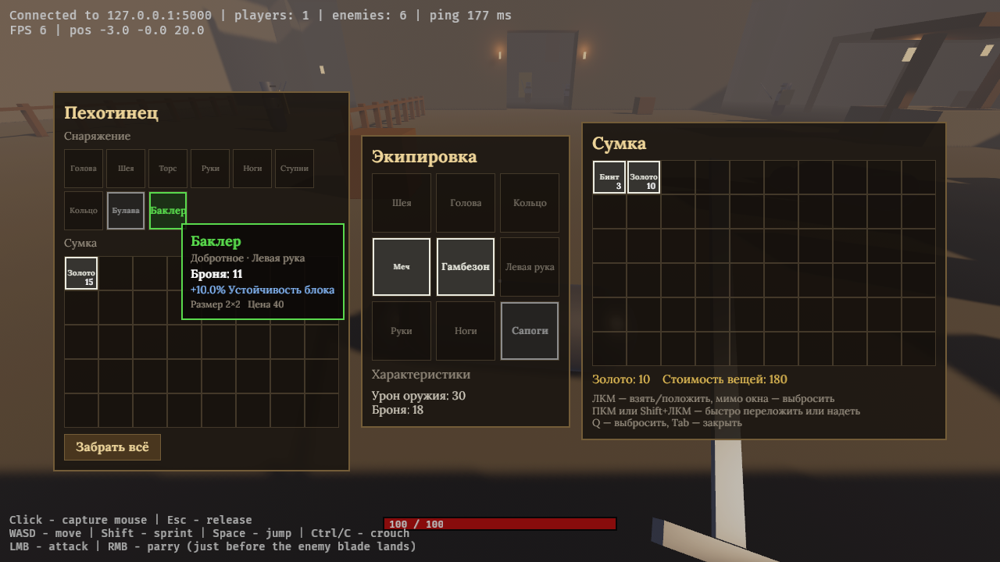

# Medieval RPG — прототип

Многопользовательская средневековая игра от первого лица на Rust и [Bevy](https://bevyengine.org).


| Неф собора | Замок сверху |
|---|---|
|  |  |

## Что нужно установить (Windows)

1. **Visual Studio** с нагрузкой «Разработка классических приложений на C++» (нужны MSVC и Windows SDK).
2. **Rust**: https://rustup.rs (установка по умолчанию).
3. **Git**: https://git-scm.com.

## Как запустить

```powershell
git clone https://github.com/mezershow1337/Medieval-RPG-Demo.git
cd Medieval-RPG-Demo
cargo run --release
```

Первая сборка идёт долго (5–15 минут), потом быстро.

| Команда | Что делает |
|---|---|
| `cargo run --release` | Хост: сервер и игра на этом компьютере |
| `cargo run --release -- join 192.168.1.5` | Подключиться к другу по его адресу (порт 5000) |
| `cargo run --release -- server` | Только сервер, без окна |

Чтобы друг подключился через интернет, на компьютере хоста нужно открыть UDP-порт 5000
(или использовать программы вроде Radmin VPN / ZeroTier).

## Управление

| Клавиша | Действие |
|---|---|
| Клик мышью | Захватить мышь |
| Esc | Отпустить мышь |
| WASD | Ходьба |
| Shift | Бег (только вперёд) |
| Пробел | Прыжок |
| Ctrl или C | Присесть |
| ЛКМ | Удар мечом (удары чередуются: справа, слева, сверху) |
| ПКМ | Парирование |
| E | Обыскать тело / подобрать предмет |
| Tab или I | Инвентарь |
| 4 / 5 | Перевязаться бинтом / выпить целебное зелье |
| F8 | (отладка) положить перед собой тело с добычей |
| F9 | Включить/выключить тяжёлые эффекты (объёмный туман, SSAO), если игра тормозит |

## Добыча и инвентарь



* Каждое тело (рыцаря или игрока) остаётся лежать, и его можно **обыскать (E)**. В теле есть и надетые
  на погибшем вещи, и содержимое сумки. Несколько игроков могут обыскивать одно тело одновременно.
* Погибший игрок оставляет в теле **всё**, что у него было, и возрождается с простым набором.
* У вещей шесть качеств: ветхое, обычное, добротное, редкое, эпическое, легендарное. Чем выше качество,
  тем выше урон или броня и тем больше случайных свойств (до 4): сила, ловкость, скорость ударов,
  **окно парирования**, устойчивость блока, удача и другие. Удача убийцы повышает шанс на хорошую добычу.
* Вещи **физически падают** на землю: их можно выбросить из инвентаря и подобрать (E).
  Редкие и лучше светятся лучом, чтобы их было видно издалека.
* Инвентарь — сетка 10×6, предметы занимают несколько клеток (меч 1×3, кираса 2×3).
  9 слотов экипировки, сумма характеристик видна под ними. У каждого предмета своя иконка (рисуется кодом).
* **Бинт** лечит 30 здоровья за 3 секунды перевязки, **зелье** пьётся 1 секунду и лечит 50 за 10 секунд.
  Удар по вам, своя атака или парирование прерывают применение.

| В инвентаре | Действие |
|---|---|
| ЛКМ по предмету | Взять в руку; ЛКМ по клетке или слоту — положить (зелёная подсветка — влезает) |
| ЛКМ мимо окон | Выбросить предмет из руки на землю |
| ПКМ или Shift+ЛКМ | Быстро переложить: из тела в сумку, из сумки в тело, надеть/снять |
| Q над предметом | Выбросить на землю |
| F над предметом (или ПКМ по бинту/зелью) | Использовать |
| «Забрать всё» | Переложить всё из тела к себе |
| Tab, E или Esc | Закрыть |

Всё решает сервер: клиент только просит переложить предмет, а сервер проверяет расстояние до тела
и место в сумке.

## Бой

* Удар идёт в три фазы: **замах → удар → восстановление**. Урон наносится только там, где реально
  проходит клинок, и только если между вами нет стены.
* **Парирование (ПКМ)** работает около 0,25 с. Нажмите его прямо перед тем, как вражеский клинок
  до вас дойдёт, и смотрите на врага. Удачное парирование оглушает противника на 1 с, а по оглушённому
  урон в 1,5 раза больше. Промах парированием оставляет вас открытым на 0,4 с.
* Попадание сбивает чужой замах: кто ударил первым, тот и прав.
* Каждый третий удар тяжёлого рыцаря **светится красным**: его нельзя парировать, только отойти.

## Враги

| Враг | Где | Поведение |
|---|---|---|
| Рыцарь с мечом и щитом | Двор, у конюшни, неф собора | Закрывается щитом, иногда парирует |
| Тяжёлый рыцарь | Перед хорами собора | Медленный двуручный меч, сильные удары, иногда парирует |

## Замок

Готический замок примерно 100 × 120 м, закатный вечер.

* **Надвратная башня** с узким проездом под стрельчатым сводом и поднятой решёткой.
* **Большой двор**: фонтан, колодец, кузница с горном, конюшня, тренировочная площадка, лестницы на стены
  (по верху стен можно ходить).
* **Внутренняя стена** с главными воротами и двумя узкими калитками — удобные места для засад.
* **Собор**: неф со стрельчатыми крестовыми сводами и нервюрами, боковые нефы за аркадой, витражи,
  роза на фасаде, хоры с троном, люстры. Снаружи — контрфорсы с аркбутанами и пинаклями, башни со шпилями.
* **Клуатр** слева от собора: крытая галерея с аркадой вокруг сада.
* **Казармы** справа: коридоры и комнаты (спальни, трапезная, арсенал, склад).
* Между ними и собором — **узкие проходы** между контрфорсами и коридор вдоль северной стены.

Графика — собственные шейдеры (`src/shaders`): процедурная каменная кладка с рельефом, мхом и грязью у земли,
плиты пола, брусчатка, дерево, сланцевая черепица, витражи со свинцовыми переплётами, живое пламя факелов,
вода, угли в горне, закатное небо с облаками и горами. Плюс HDR, блум, SSAO, сглаживание TAA,
объёмный туман с лучами солнца и мерцающий свет факелов.

Враги возрождаются через 60 секунд, игрок — через 5 секунд (ещё 4 секунды после появления враги его не трогают).
После смерти тело остаётся лежать на земле.

## Устройство кода

| Файл | Что внутри |
|---|---|
| `src/main.rs` | Запуск в режиме хоста, клиента или сервера |
| `src/protocol.rs` | Сетевые сообщения между клиентом и сервером |
| `src/server.rs` | Сервер без графики: игроки, проверка перемещений, рассылка состояния |
| `src/client.rs` | Окно игры, подключение, отображение других игроков |
| `src/player.rs` | Управление персонажем и камера от первого лица |
| `src/collision.rs` | Своя простая физика: столкновения со стенами, ступеньки |
| `src/level.rs` | Планировка замка: коллизии-коробки, стены с проёмами, башни, собор, точки появления |
| `src/level/geom.rs` | Процедурная геометрия: стрельчатые арки, своды с нервюрами, шпили, крыши, аркбутаны |
| `src/graphics.rs` | Материалы, небо, солнце, пост-обработка (блум, SSAO, TAA, объёмный туман) |
| `src/shaders/*.wesl` | Шейдеры: камень и другие поверхности, витражи, пламя, небо |
| `src/combat.rs` | Общая логика боя: фазы удара, траектория клинка, парирование, блок |
| `src/npc.rs` | ИИ рыцарей (только на сервере) |
| `src/fight.rs` | Бой на клиенте: ввод, меч в руках, искры, надписи |
| `src/hud.rs` | Прицел и строка состояния |
| `src/rig.rs` | Модели персонажей и их анимация (скелет, IK рук и ног) |
| `src/items.rs` | Предметы, качество, случайные свойства, таблицы добычи |
| `src/inventory.rs` | Логика инвентаря: сетка, экипировка, обмен, стопки |
| `src/loot_net.rs` | Сетевые сообщения добычи (свой канал) и полёт брошенных вещей |
| `src/loot_server.rs` | Сервер: тела с добычей, вещи на земле, инвентари игроков |
| `src/loot_client.rs` | Клиент: модели вещей и тел, подсказка «E», приём состояния |
| `src/icons.rs` | Иконки предметов, нарисованные кодом |
| `src/consumables.rs` | Сервер: бинты и зелья, лечение |
| `src/inventory_ui.rs` | Окно инвентаря и обыска, шрифт с кириллицей (Lora, OFL) |

## План

1. ✅ Фундамент: сеть, персонаж, замок из блоков.
2. ✅ Большой готический замок с процедурной геометрией и шейдерами.
3. ✅ Ближний бой и парирование, враги-рыцари.
4. ✅ Тела, которые можно обыскать, инвентарь, предметы разного качества.
5. ✅ Модели игрока и рыцарей с анимацией; дальше — детали замка.

## Модели персонажей


Игрок, рыцарь с мечом и щитом и тяжёлый рыцарь — оригинальные модели, собранные кодом в Blender
(`assets/models/characters.glb`). Тело состоит из деталей (таз, торс, голова, руки, ноги), броня —
отдельные детали по слотам экипировки: голова, торс, руки, ноги, ступни. Анимации считаются в игре
(`src/rig.rs`): руки держат рукоять и щит, ноги шагают, торс поворачивается за ударом, при оглушении
боец откидывается назад, убитый падает навзничь, а оружие остаётся лежать рядом.


Пересобрать модели (нужен Python 3 и модуль Blender: `pip install bpy numpy pillow`):

```bash
python3 tools/models/textures.py
python3 tools/models/build_characters.py --preview docs/characters.png
```
