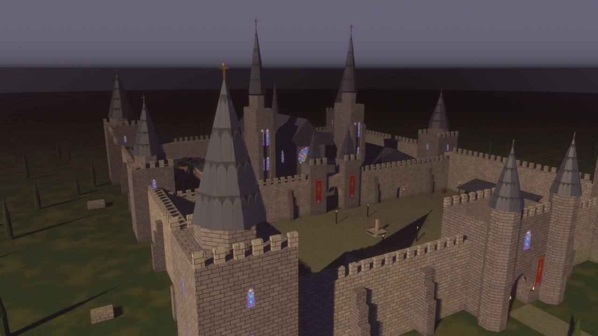

# Medieval RPG — прототип

Многопользовательская средневековая игра от первого лица на Rust и [Bevy](https://bevyengine.org).


| Неф собора | Замок сверху |
|---|---|
|  |  |

## Что нужно установить (Windows)

1. **Visual Studio** с нагрузкой «Разработка классических приложений на C++» (нужны MSVC и Windows SDK).
2. **Rust**: https://rustup.rs (установка по умолчанию).
3. **Git**: https://git-scm.com.

## Как запустить

```powershell
git clone https://github.com/mezershow1337/Medieval-RPG-Demo.git
cd Medieval-RPG-Demo
cargo run --release
```

Первая сборка идёт долго (5–15 минут), потом быстро.

| Команда | Что делает |
|---|---|
| `cargo run --release` | Хост: сервер и игра на этом компьютере |
| `cargo run --release -- join 192.168.1.5` | Подключиться к другу по его адресу (порт 5000) |
| `cargo run --release -- server` | Только сервер, без окна |

Чтобы друг подключился через интернет, на компьютере хоста нужно открыть UDP-порт 5000
(или использовать программы вроде Radmin VPN / ZeroTier).

## Управление

| Клавиша | Действие |
|---|---|
| Клик мышью | Захватить мышь |
| Esc | Отпустить мышь |
| WASD | Ходьба |
| Shift | Бег (только вперёд) |
| Пробел | Прыжок |
| Ctrl или C | Присесть |
| ЛКМ | Удар мечом (удары чередуются: справа, слева, сверху) |
| ПКМ | Парирование |
| F9 | Включить/выключить тяжёлые эффекты (объёмный туман, SSAO), если игра тормозит |

## Бой

* Удар идёт в три фазы: **замах → удар → восстановление**. Урон наносится только там, где реально
  проходит клинок, и только если между вами нет стены.
* **Парирование (ПКМ)** работает около 0,25 с. Нажмите его прямо перед тем, как вражеский клинок
  до вас дойдёт, и смотрите на врага. Удачное парирование оглушает противника на 1 с, а по оглушённому
  урон в 1,5 раза больше. Промах парированием оставляет вас открытым на 0,4 с.
* Попадание сбивает чужой замах: кто ударил первым, тот и прав.
* Каждый третий удар тяжёлого рыцаря **светится красным**: его нельзя парировать, только отойти.

## Враги

| Враг | Где | Поведение |
|---|---|---|
| Рыцарь с мечом и щитом | Двор, у конюшни, неф собора | Закрывается щитом, иногда парирует |
| Тяжёлый рыцарь | Перед хорами собора | Медленный двуручный меч, сильные удары, иногда парирует |

## Замок

Готический замок примерно 100 × 120 м, закатный вечер.

* **Надвратная башня** с узким проездом под стрельчатым сводом и поднятой решёткой.
* **Большой двор**: фонтан, колодец, кузница с горном, конюшня, тренировочная площадка, лестницы на стены
  (по верху стен можно ходить).
* **Внутренняя стена** с главными воротами и двумя узкими калитками — удобные места для засад.
* **Собор**: неф со стрельчатыми крестовыми сводами и нервюрами, боковые нефы за аркадой, витражи,
  роза на фасаде, хоры с троном, люстры. Снаружи — контрфорсы с аркбутанами и пинаклями, башни со шпилями.
* **Клуатр** слева от собора: крытая галерея с аркадой вокруг сада.
* **Казармы** справа: коридоры и комнаты (спальни, трапезная, арсенал, склад).
* Между ними и собором — **узкие проходы** между контрфорсами и коридор вдоль северной стены.

Графика — собственные шейдеры (`src/shaders`): процедурная каменная кладка с рельефом, мхом и грязью у земли,
плиты пола, брусчатка, дерево, сланцевая черепица, витражи со свинцовыми переплётами, живое пламя факелов,
вода, угли в горне, закатное небо с облаками и горами. Плюс HDR, блум, SSAO, сглаживание TAA,
объёмный туман с лучами солнца и мерцающий свет факелов.

Враги возрождаются через 60 секунд, игрок — через 5 секунд (ещё 4 секунды после появления враги его не трогают).
После смерти тело остаётся лежать на земле.

## Устройство кода

| Файл | Что внутри |
|---|---|
| `src/main.rs` | Запуск в режиме хоста, клиента или сервера |
| `src/protocol.rs` | Сетевые сообщения между клиентом и сервером |
| `src/server.rs` | Сервер без графики: игроки, проверка перемещений, рассылка состояния |
| `src/client.rs` | Окно игры, подключение, отображение других игроков |
| `src/player.rs` | Управление персонажем и камера от первого лица |
| `src/collision.rs` | Своя простая физика: столкновения со стенами, ступеньки |
| `src/level.rs` | Планировка замка: коллизии-коробки, стены с проёмами, башни, собор, точки появления |
| `src/level/geom.rs` | Процедурная геометрия: стрельчатые арки, своды с нервюрами, шпили, крыши, аркбутаны |
| `src/graphics.rs` | Материалы, небо, солнце, пост-обработка (блум, SSAO, TAA, объёмный туман) |
| `src/shaders/*.wesl` | Шейдеры: камень и другие поверхности, витражи, пламя, небо |
| `src/combat.rs` | Общая логика боя: фазы удара, траектория клинка, парирование, блок |
| `src/npc.rs` | ИИ рыцарей (только на сервере) |
| `src/fight.rs` | Бой на клиенте: ввод, меч в руках, искры, надписи |
| `src/hud.rs` | Прицел и строка состояния |

## План

1. ✅ Фундамент: сеть, персонаж, замок из блоков.
2. ✅ Большой готический замок с процедурной геометрией и шейдерами.
3. ✅ Ближний бой и парирование, враги-рыцари.
4. Тела, которые можно обыскать, которые можно обыскать, инвентарь, предметы разного качества.
5. Модели из Blender (рыцари, оружие, детали замка).
