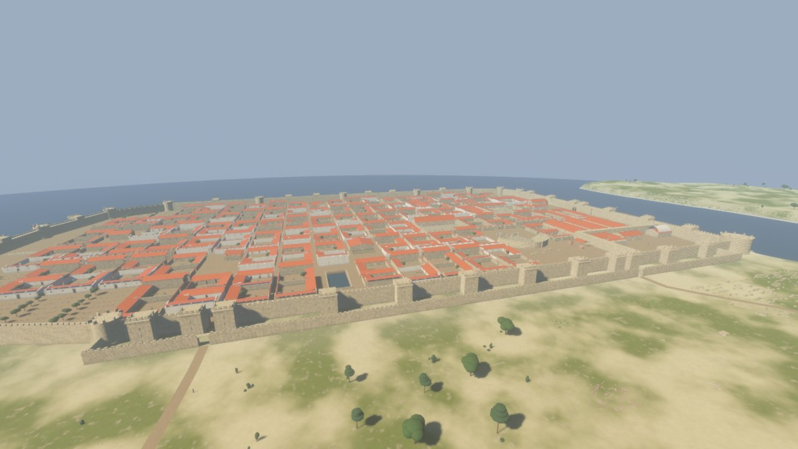
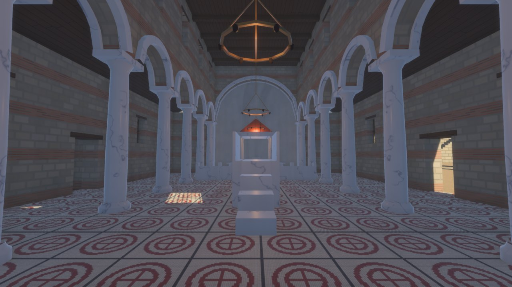
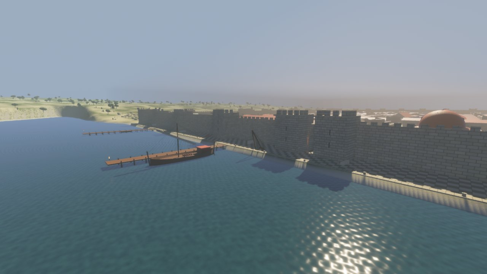
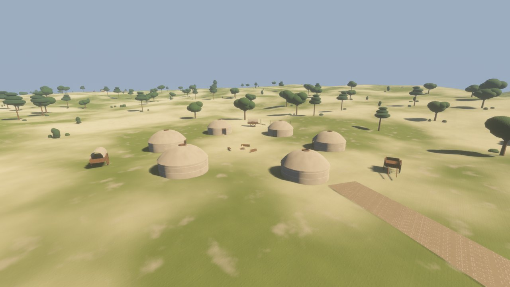
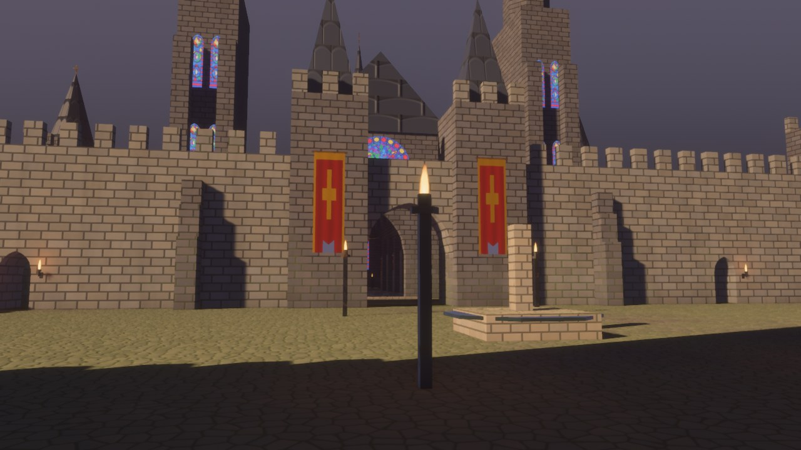
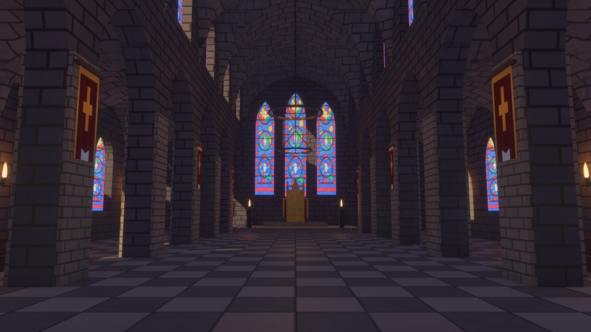
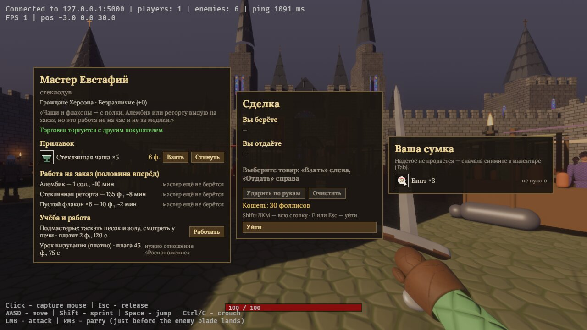
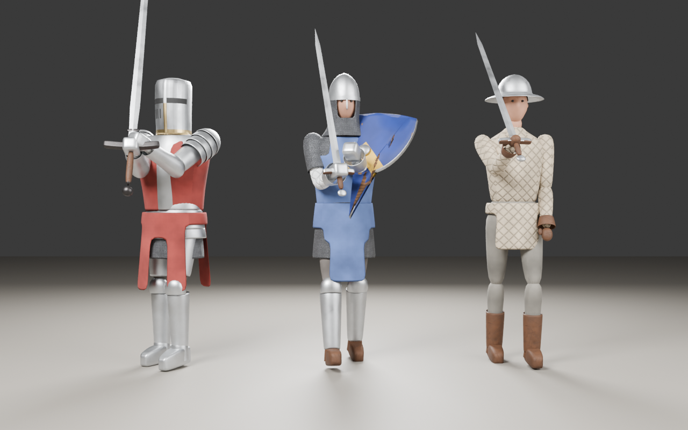
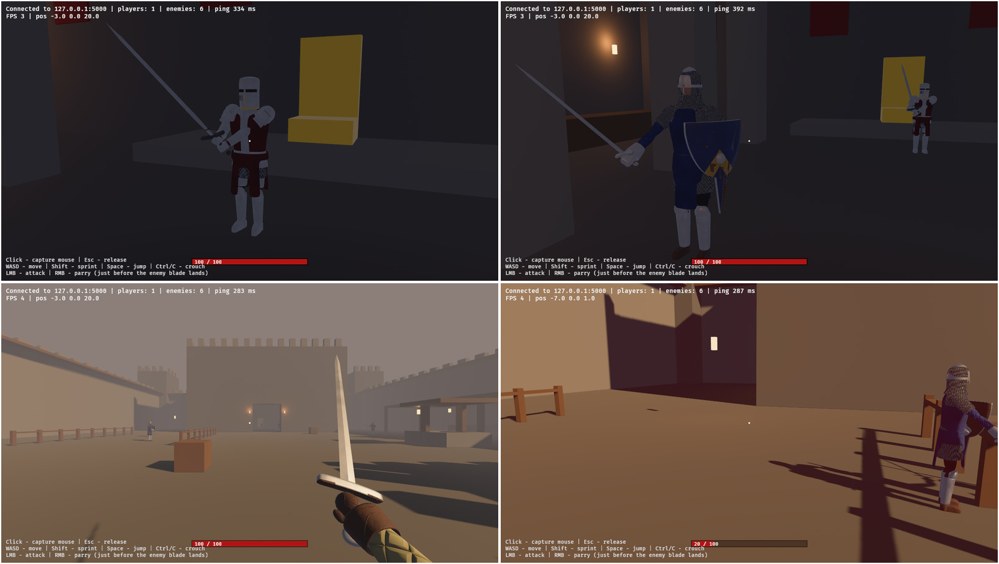

# Medieval RPG — прототип

Многопользовательская средневековая игра от первого лица на Rust и [Bevy](https://bevyengine.org).

Место действия — **Херсонес (Херсон) около 510 года**, форпост Восточной Римской империи в Крыму.



| Базилика епископа | Порт в Карантинной бухте |
|---|---|
|  |  |
| **Некрополь за южными воротами** | **Стан кочевников** |
|  |  |

## Что нужно установить (Windows)

1. **Visual Studio** с нагрузкой «Разработка классических приложений на C++» (нужны MSVC и Windows SDK).
2. **Rust**: https://rustup.rs (установка по умолчанию).
3. **Git**: https://git-scm.com.

## Как запустить

```powershell
git clone https://github.com/mezershow1337/Medieval-RPG-Demo.git
cd Medieval-RPG-Demo
cargo run --release
```

Первая сборка идёт долго (5–15 минут), потом быстро.

| Команда | Что делает |
|---|---|
| `cargo run --release` | Хост: сервер и игра на этом компьютере |
| `cargo run --release -- join 192.168.1.5` | Подключиться к другу по его адресу (порт 5000) |
| `cargo run --release -- server` | Только сервер, без окна |

Уровень по умолчанию — Херсонес. Старый готический замок включается переменной окружения
(одинаково у сервера и у всех игроков): в PowerShell `$env:MEDIEVAL_LEVEL="castle"; cargo run --release`.

Чтобы друг подключился через интернет, на компьютере хоста нужно открыть UDP-порт 5000
(или использовать программы вроде Radmin VPN / ZeroTier).

## Управление

| Клавиша | Действие |
|---|---|
| Клик мышью | Захватить мышь |
| Esc | Отпустить мышь |
| WASD | Ходьба |
| Shift | Бег (только вперёд) |
| Пробел | Прыжок |
| Ctrl или C | Присесть |
| ЛКМ | Удар мечом (удары чередуются: справа, слева, сверху) |
| ПКМ | Парирование |
| E | Обыскать тело / подобрать предмет |
| Tab или I | Инвентарь |
| 4 / 5 | Перевязаться бинтом / выпить целебное зелье |
| F8 | (отладка) положить перед собой тело с добычей |
| F9 | Включить/выключить тяжёлые эффекты (объёмный туман, SSAO), если игра тормозит |

## Добыча и инвентарь


* Каждое тело (рыцаря или игрока) остаётся лежать, и его можно **обыскать (E)**. В теле есть и надетые
  на погибшем вещи, и содержимое сумки. Несколько игроков могут обыскивать одно тело одновременно.
* Погибший игрок оставляет в теле **всё**, что у него было, и возрождается с простым набором.
* У вещей шесть качеств: ветхое, обычное, добротное, редкое, эпическое, легендарное. Чем выше качество,
  тем выше урон или броня и тем больше случайных свойств (до 4): сила, ловкость, скорость ударов,
  **окно парирования**, устойчивость блока, удача и другие. Удача убийцы повышает шанс на хорошую добычу.
* Вещи **физически падают** на землю: их можно выбросить из инвентаря и подобрать (E).
  Редкие и лучше светятся лучом, чтобы их было видно издалека.
* Инвентарь — сетка 10×6, предметы занимают несколько клеток (меч 1×3, кираса 2×3).
  9 слотов экипировки, сумма характеристик видна под ними. У каждого предмета своя иконка (рисуется кодом).
* **Бинт** лечит 30 здоровья за 3 секунды перевязки, **зелье** пьётся 1 секунду и лечит 50 за 10 секунд.
  Удар по вам, своя атака или парирование прерывают применение.

| В инвентаре | Действие |
|---|---|
| ЛКМ по предмету | Взять в руку; ЛКМ по клетке или слоту — положить (зелёная подсветка — влезает) |
| ЛКМ мимо окон | Выбросить предмет из руки на землю |
| ПКМ или Shift+ЛКМ | Быстро переложить: из тела в сумку, из сумки в тело, надеть/снять |
| Q над предметом | Выбросить на землю |
| F над предметом (или ПКМ по бинту/зелью) | Использовать |
| «Забрать всё» | Переложить всё из тела к себе |
| Tab, E или Esc | Закрыть |

Всё решает сервер: клиент только просит переложить предмет, а сервер проверяет расстояние до тела
и место в сумке.

## Бой

* Удар идёт в три фазы: **замах → удар → восстановление**. Урон наносится только там, где реально
  проходит клинок, и только если между вами нет стены. Удары идут серией (справа, слева, сверху);
  пауза больше 0,7 с начинает серию заново.
* **Защита (держите ПКМ).** Стойка поднимается за 0,15 с (со щитом за 0,2 с) и закрывает сектор
  примерно ±75° перед вами. Со спины защита не работает. Пока держите стойку, вы идёте медленнее.
  Защиту можно поднять прямо во время своего замаха, отменив удар (финт).
* **Парирование оружием.** Удар, пришедший в поднятое оружие, отражается: нападающий оглушён,
  а у вас появляется окно для **ответного удара (ЛКМ)**: быстрый замах и урон ×1,3.
  Чем сильнее чужое оружие, тем дольше вы сами вздрагиваете после парирования.
* **Блок щитом.** Лёгкий удар (меч) отскакивает от щита и сбивает серию нападающего.
  Тяжёлый удар (двуручник) пробивает темп: нападающий продолжает, а вас качает дольше.
* Клинок, задевший стену, **отскакивает**: короткое оглушение и сброс серии. В тесных коридорах
  бейте сверху.
* Попадание в голову ×1,5. Броня снижает урон. Попадание сбивает чужой замах, но не поднятую стойку.
* Бой стал медленнее: у игрока 150 здоровья, удары медленнее и слабее, враги ходят и бьют реже.
* **Выносливость** (жёлтая полоска под здоровьем). Тратится на бег, удары и на каждый удар,
  принятый на защиту. Если силы кончились в стойке, защиту пробивает и вас оглушает.
  Без сил нельзя замахнуться и бежать. Силы восстанавливаются после короткой паузы, в стойке медленнее.
* **Снаряжение влияет на бой.** Оружие в руке задаёт темп и длину ударов (меч — спата, топор,
  кинжал — сакс, древковое — копьё). «Скорость действий» ускоряет удары, «Устойчивость блока»
  снижает потерю сил при блоке, «Сила» добавляет выносливости, «Ловкость» ускоряет отдых.
  Тяжёлый доспех замедляет ходьбу и восстановление сил.

## Оружие

| Оружие | Удары | Особенности |
|---|---|---|
| Спата | Серия справа, слева, сверху | Ровное оружие, нормально парирует |
| Топор | Как у спаты, короче | Пробивает щит (противник продолжает серию), плохо парирует |
| Сакс (нож) | Быстрые и короткие | Слабый урон, почти не держит удар |
| Копьё (контос) | Только уколы, ~2 м | Держит врага на расстоянии, вблизи неудобно |
| Лук | Натяжение и выстрел | Стрелы летят по дуге; щит их держит, оружием стрелу не отбить |

## Враги

Люди Херсона и его округи около 510 г.

| Враг | Оружие | Поведение |
|---|---|---|
| Стратиот (гарнизон) | Спата и овальный щит | Часто закрывается щитом, обходит сбоку, если вы в стойке |
| Букелларий (гарнизон) | Спата и овальный щит, ламеллярный доспех | Медленный и крепкий, закрывается почти всегда |
| Готский воин | Топор и круглый щит | Напирает и часто рубит, топор продавливает ваш щит |
| Аланский копейщик | Копьё-контос | Держит дистанцию копья; парируйте и подходите вплотную |
| Кочевник-лучник | Лук, вблизи нож | Стреляет издали и отходит; поднимите щит или сократите дистанцию |

Модели врагов пока временные (старые рыцари), модели эпохи делаются отдельно.

## Херсонес, 510 год

Город и его округа примерно 1,8 × 1,8 км, ясный летний день. Всё сделано кодом (процедурная геометрия
и свои шейдеры), без чужих моделей. Размеры — по раскопкам: кварталы, улицы и стены в масштабе 1 : 1,
кварталов меньше, чем в настоящем городе (около двух третей площади).

**Стены и ворота.** Куртины из крупных известняковых блоков 9 м высотой и 3,5 м толщиной с зубцами,
прямоугольные башни, круглые угловые башни и **башня Зенона** (Ø 19 м) в юго-восточном углу — её подновили
в 488 г. на таможенные сборы, на ней мраморная плита с надписью. Перед южной (сухопутной) стеной —
низкая **протейхизма** с периболом между стенами. Главные ворота, южные ворота к некрополю, портовые ворота
к бухте. На стены ведут лестницы, по верху можно ходить.

**Город.** Регулярная сетка: главная продольная улица ~6 м, мощёная плитами с крытым водостоком,
поперечные улицы ~3,5 м, кварталы 23 × 47 м, в каждом две усадьбы с двором, цистерной, пифосами, смоковницей
или виноградной лозой. Дома из бута или белёные, одно- и двухэтажные, под черепицей; в фасадах — лавки.

* **Агора** со стоями, фонтаном-водоразборником, колонной с крестом и рядами торговцев.
* **Базилика епископа**: атриум с фиалой, нартекс, трёхнефный зал на мраморных колоннах, апсида с синтроном,
  алтарь под киворием, амвон, мозаичный пол; рядом **баптистерий** с куполом и крестообразной купелью.
* **Ксенон** (больница при епископии): палаты с койками, кабинет врача (ятрейон), кладовая лекарств и кухня,
  огород лекарственных трав во дворе.
* **Дидаскалион** (школа): аудитория со скамьями и кафедрой, книгохранилище со шкафами для свитков.
* **Аптеки** у агоры и у порта, **лавка книжника**, **корчмы**.
* **Дом знатных ссыльных** с мозаиками, триклинием и фонтаном.
* **Термы**: залы со сводами, бассейны, топка, палестра. **Заброшенный театр** — зрелища запрещены,
  камень разбирают на стройки. **Резервуар водопровода** 28 × 13 м.
* **Цитадель** у бухты: претория, казармы, зернохранилище, бани гарнизона, плац с чучелом.
* **Мастерские**: стекольная (купольная печь, отжиг, стеклянная посуда), гончарная (две печи, круг, сушильни),
  кузница, винодельня-тарапан с давильнями, рыбозасолочные цистерны из цемянки.
* **Порт** в Карантинной бухте: каменная набережная, пирсы, торговый корабль, лодки, кран, грузы,
  портовый торг, таможня (коммеркиарий), склады-горреи.

**Округа.** Плато Гераклейского полуострова с балками, морем на севере и бухтами по бокам.
Грунтовые дороги ведут к **некрополю** (плитовые могилы со стелами-крестами, саркофаги, склепы,
поминальная церковь), к **клеру** (виноградники за каменными оградами, усадьба с башней и давильней),
к **роднику** в балке, к **селению крымских готов** (каменные дома под камышом на террасах, ток, загон),
к **стану гунно-булгар** (войлочные юрты, кибитки, коновязь) и к **аланскому стану** (кольцо повозок, шатры).
Склоны — можжевельник, крымская сосна, дуб пушистый, известняковые выходы. Лекарственные травы растут
там, где им положено: шалфей и чабрец — на каменистых склонах, полынь — в степи, белена и мальва — у дорог
и жилья, мята, окопник и девясил — по сырому дну балки у родника.

Для других частей игры в коде есть именованные места (`level::places()`: агора, ксенон, дидаскалион,
аптеки, мастерские, станы и т. д.), заросли трав (`level::herb_patches()`), посты стражи и разбойников
(`level::npc_posts()`) и очаги (`level::hearths()`). Тесты проверяют, что до каждого места в городе
можно дойти от агоры и что ни одна точка не стоит в стене.

## Замок

Готический замок примерно 100 × 120 м, закатный вечер (`MEDIEVAL_LEVEL=castle`).

| Двор | Неф собора | Замок сверху |
|---|---|---|
|  |  |  |

* **Надвратная башня** с узким проездом под стрельчатым сводом и поднятой решёткой.
* **Большой двор**: фонтан, колодец, кузница с горном, конюшня, тренировочная площадка, лестницы на стены
  (по верху стен можно ходить).
* **Внутренняя стена** с главными воротами и двумя узкими калитками — удобные места для засад.
* **Собор**: неф со стрельчатыми крестовыми сводами и нервюрами, боковые нефы за аркадой, витражи,
  роза на фасаде, хоры с троном, люстры. Снаружи — контрфорсы с аркбутанами и пинаклями, башни со шпилями.
* **Клуатр** слева от собора: крытая галерея с аркадой вокруг сада.
* **Казармы** справа: коридоры и комнаты (спальни, трапезная, арсенал, склад).
* Между ними и собором — **узкие проходы** между контрфорсами и коридор вдоль северной стены.

Графика — собственные шейдеры (`src/shaders`): процедурная каменная кладка с рельефом, мхом и грязью у земли,
плиты пола, брусчатка, дерево, сланцевая черепица, витражи со свинцовыми переплётами, живое пламя факелов,
вода, угли в горне, закатное небо с облаками и горами. Плюс HDR, блум, SSAO, сглаживание TAA,
объёмный туман с лучами солнца и мерцающий свет факелов.

Враги возрождаются через 60 секунд, игрок — через 5 секунд (ещё 4 секунды после появления враги его не трогают).
После смерти тело остаётся лежать на земле.

## Торговля и фракции (Херсон, 510 год)



Деньги — как после реформы Анастасия (498 г.): **солид** (золото, 1/72 фунта), **тремисс** (треть солида),
медный **фоллис** с буквой «M» (40 нуммиев) и **декануммий** (10 нуммиев). Курс — около 180 фоллисов за солид.
При оплате торговец сам отсчитывает сдачу. Поденщик зарабатывает около 6 фоллисов в день, кольчуга стоит
два солида, переписанный Гален — три.

* **21 торговец и мастер**: в порту — навикулярий из Синопы (вино, масло, стекло), сириец с пряностями
  и благовониями, торговец серой, квасцами и боспорской нефтью; на агоре — лавочник, книжник, аптекари,
  красильщик; в мастерских — стеклодув, гончар, медник; рыбозасольщица; врач монастырского ксенона;
  казначей гарнизона; опальный сенатор и сосланный философ; хозяин портовой таверны (скупщик краденого);
  за стенами — готский староста из Дори, аланский старейшина и торговец кочевой орды.
* Цена зависит от лавки, запаса на полке и **отношения фракции** к вам. Каждый покупает только своё
  (порт охотно берёт рыбу, соль, шкуры, воск и мёд — их и везли из Херсона).
* **За стенами — мена**: медь там не берут, золото ценят, платят товаром. Выгодный круг — вино в степь,
  степной ревень и солодку обратно сирийцу.
* **Заказы**: стеклодув выдует алембик или реторту, медник — керотакис и весы, книжник перепишет
  Орибасия. Половина вперёд, вещь готова через несколько минут, заказная чаще выходит добротной.
* **Учёба и работа**: платные уроки у мастеров, работа подмастерьем и смены в ксеноне (платят гроши,
  но учат). Нельзя отходить от мастера, пока урок не кончится; X — бросить.
* **Кража** (кнопка «Стянуть» у мелких вещей): легче, когда торговец отвлёкся («пересчитывает выручку»).
  Пойманный платит по римскому праву **четверную цену**, теряет репутацию и попадает в розыск: пока штраф
  не уплачен казначею гарнизона, горожане не торгуют. Краденое лучше сбыть скупщику — хозяин вещь узнает.
* **Оружие варварам** продавать запрещено законом: кто-нибудь может донести в гарнизон.
* **Обмен между игроками**: посмотрите на игрока и нажмите **T**, он отвечает **Y/N**. Каждый выкладывает
  вещи и деньги, обмен проходит, когда согласны оба (любое изменение снимает согласие).
* **Фракции (J)**: гарнизон, граждане, церковь, заморские купцы, ссыльные, крымские готы, аланы,
  кочевники, портовое дно. Отношения связаны: помощь готам радует гарнизон и злит кочевников.

| Клавиша | Действие |
|---|---|
| E (на торговца) | Говорить и торговать |
| T (на игрока) / Y / N | Предложить обмен / принять / отказать |
| J | Отношения фракций и розыск |
| X | Бросить урок или смену |

## Устройство кода

| Файл | Что внутри |
|---|---|
| `src/main.rs` | Запуск в режиме хоста, клиента или сервера |
| `src/protocol.rs` | Сетевые сообщения между клиентом и сервером |
| `src/server.rs` | Сервер без графики: игроки, проверка перемещений, рассылка состояния |
| `src/client.rs` | Окно игры, подключение, отображение других игроков |
| `src/player.rs` | Управление персонажем и камера от первого лица |
| `src/collision.rs` | Своя простая физика: столкновения со стенами, ступеньки, склоны холмов, сетка для быстрого поиска |
| `src/level.rs` | Общий сборщик уровня (коробки-коллизии, меши по участкам 64 м, свет), выбор уровня |
| `src/level/city.rs` | Херсонес: сетка кварталов, улицы, что стоит в каком квартале |
| `src/level/city/*.rs` | Стены и башни, дома, общественные здания, мастерские, порт, округа; `kit.rs` — стены, крыши, утварь, деревья |
| `src/level/terrain.rs` | Рельеф: берег, бухты, балки, холмы; карта высот для ходьбы и меш земли |
| `src/level/places.rs` | Именованные места, заросли трав, посты, очаги — для торговли, обучения, врагов |
| `src/level/castle.rs` | Старый готический замок |
| `src/level/geom.rs` | Процедурная геометрия: арки, своды, купола, тела вращения, крыши, шпили |
| `src/graphics.rs` | Материалы, небо, солнце, пост-обработка (блум, SSAO, TAA, объёмный туман) |
| `src/shaders/*.wesl` | Шейдеры: камень и другие поверхности, витражи, пламя, небо |
| `src/combat.rs` | Общая логика боя: фазы удара, траектория клинка, стойка, парирование, блок щитом, ответный удар |
| `src/npc.rs` | ИИ рыцарей (только на сервере) |
| `src/fight.rs` | Бой на клиенте: ввод, меч в руках, искры, надписи |
| `src/hud.rs` | Прицел и строка состояния |
| `src/rig.rs` | Модели персонажей и их анимация (скелет, IK рук и ног) |
| `src/items.rs` | Предметы, качество, случайные свойства, таблицы добычи |
| `src/inventory.rs` | Логика инвентаря: сетка, экипировка, обмен, стопки |
| `src/loot_net.rs` | Сетевые сообщения добычи (свой канал) и полёт брошенных вещей |
| `src/loot_server.rs` | Сервер: тела с добычей, вещи на земле, инвентари игроков |
| `src/loot_client.rs` | Клиент: модели вещей и тел, подсказка «E», приём состояния |
| `src/icons.rs` | Иконки предметов, нарисованные кодом |
| `src/consumables.rs` | Сервер: бинты и зелья, лечение |
| `src/inventory_ui.rs` | Окно инвентаря и обыска, шрифт с кириллицей (Lora, OFL) |
| `src/economy.rs` | Монеты 510 года, оплата со сдачей, справочные цены |
| `src/factions.rs` | Фракции, репутация и её отголоски, преступления и штрафы |
| `src/trade.rs` | Торговцы и мастера, виды товаров, формулы цен, бартер, вероятность кражи |
| `src/trade_net.rs` | Сетевые сообщения торговли (канал 7) |
| `src/trade_server.rs` | Сервер: полки, сделки, заказы, уроки, кража, штрафы, обмен между игроками |
| `src/trade_client.rs` | Клиент: торговцы с прилавками, клавиши E/T/Y/N/J/X |
| `src/trade_ui.rs` | Окна торговли, обмена и репутации |
| `src/trade_icons.rs` | Иконки монет и товаров |

## План

1. ✅ Фундамент: сеть, персонаж, замок из блоков.
2. ✅ Большой готический замок с процедурной геометрией и шейдерами.
3. ✅ Ближний бой и парирование, враги-рыцари.
4. ✅ Тела, которые можно обыскать, инвентарь, предметы разного качества.
5. ✅ Модели игрока и рыцарей с анимацией.
6. ✅ Херсонес около 510 года: город, порт, округа, станы соседей, места для торговли и обучения.

## Модели персонажей



Игрок, рыцарь с мечом и щитом и тяжёлый рыцарь — оригинальные модели, собранные кодом в Blender
(`assets/models/characters.glb`). Тело состоит из деталей (таз, торс, голова, руки, ноги), броня —
отдельные детали по слотам экипировки: голова, торс, руки, ноги, ступни. Анимации считаются в игре
(`src/rig.rs`): руки держат рукоять и щит, ноги шагают, торс поворачивается за ударом, при оглушении
боец откидывается назад, убитый падает навзничь, а оружие остаётся лежать рядом.



Пересобрать модели (нужен Python 3 и модуль Blender: `pip install bpy numpy pillow`):

```bash
python3 tools/models/textures.py
python3 tools/models/build_characters.py --preview docs/characters.png
```
